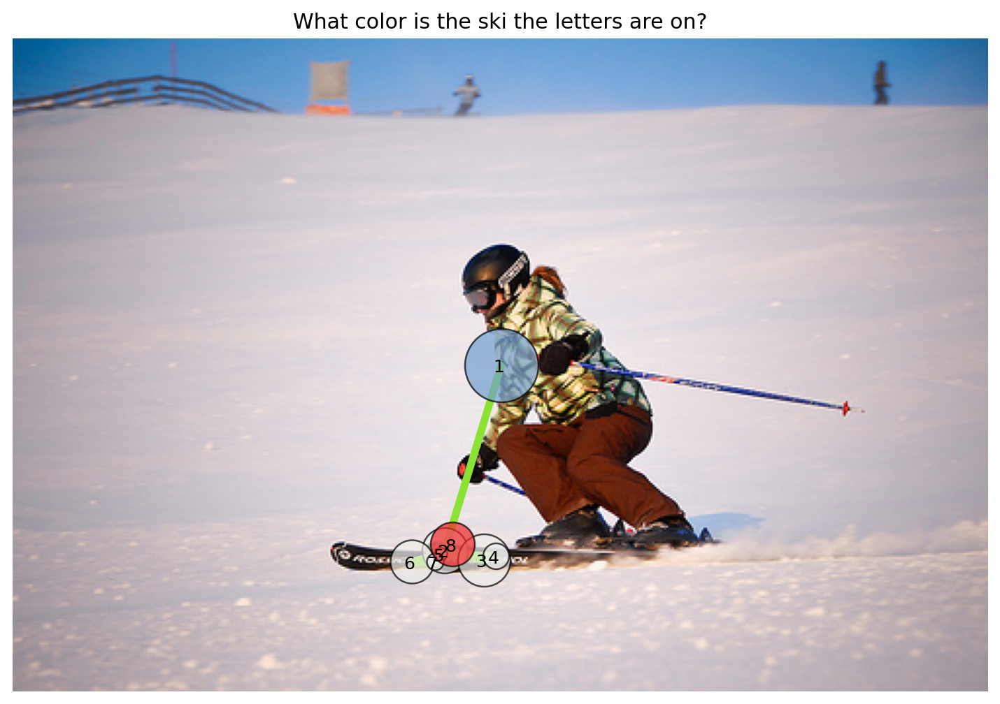
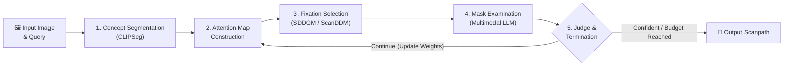

<div align="center">

# Eyegent: Visual Attention Orchestration on Concepts

**An Active Vision Agent for Concept-Driven Visual Exploration and Human-Like Scanpath Prediction**

[**Alessandro D’Amelio**](https://github.com/phuselab) · [**Sabrina Patania**](https://github.com/phuselab) · [**Luca Annese**](https://github.com/phuselab) · [**Giuseppe Boccignone**](https://github.com/phuselab)

*PHUSE Lab — University of Milan*

[](https://doi.org/10.1007/s11263-026-03042-4)
[](https://doi.org/10.1007/s11263-026-03042-4)
[](#installation)
[](#installation)

[**Overview**](#-overview) · [**How It Works**](#-how-it-works) · [**Installation**](#-installation) · [**Quickstart**](#-quickstart) · [**Configuration**](#%EF%B8%8F-configuration) · [**Citation**](#-citation)

---



*Example scanpath simulated by **Eyegent** on `examples/ski.jpg` for the query: **“What color is the ski the letters are on?”***

</div>

---

## 📖 Overview

**Eyegent** is an active vision agent that performs concept-driven visual exploration on images. Given an input image and a natural-language query, Eyegent orchestrates an iterative perception-action loop of **open-vocabulary segmentation**, **stochastic fixation prediction**, and **multimodal relevance evaluation** to progressively focus on the regions most aligned with the query—producing a simulated, human-like visual scanpath.

This repository contains the official implementation accompanying the paper:
> [**Eyegent: Visual Attention Orchestration on Concepts**](https://doi.org/10.1007/s11263-026-03042-4)  
> *Alessandro D’Amelio, Sabrina Patania, Luca Annese, and Giuseppe Boccignone*  
> **International Journal of Computer Vision (IJCV)**, 2026.

---

## 🧠 How It Works

Eyegent operates through a recurrent perception cycle orchestrated by a Vision-Language Model (VLM):



1. **Concept-Based Segmentation (`segment_phrase`)** — A phrase-guided segmentation backend (**CLIPSeg**) generates candidate concept masks across the image.
2. **Attention Map Construction** — Candidate masks are combined and assigned dynamic weights representing their expected task relevance.
3. **Fixation Selection (`predict_foa`)** — The **Spatial Drift-Diffusion Gaze Model (SDDGM / `ScanDDM`)** samples the next Focus of Attention (FOA) and fixation duration from the weighted spatial map.
4. **Mask Examination (`examine_mask`)** — The region at the current fixation is isolated, visualized, and evaluated by a Multimodal LLM for semantic alignment with the query.
5. **Attention Update & Termination (`judge`)** — Relevance scores update the spatial priority map for subsequent fixations until a termination criterion fires (confidence threshold, simulated duration limit, or tool-call budget).

---

## 🛠️ Installation

### Prerequisites

- **Python**: `3.11` or `3.12` (commands below use `python3.12`)
- **Hardware**: CPU or CUDA-enabled GPU for CLIPSeg and ScanDDM; a CUDA GPU with sufficient VRAM for serving the VLM (e.g., `Qwen/Qwen3-VL-8B-Instruct`)
- **VLM Server**: Any OpenAI-compatible multimodal server (e.g., [vLLM](https://docs.vllm.ai/en/latest/serving/openai_compatible_server/))
- **Network**: Internet access on first run to automatically pull public CLIPSeg and Qwen checkpoints from Hugging Face

### 1. Install Eyegent

Clone the repository and install the package in a dedicated virtual environment:

```bash
python3.12 -m venv .venv
source .venv/bin/activate
python -m pip install --upgrade pip
python -m pip install -e .
```

> [!NOTE]
> - **PyTorch CUDA Builds**: `pip install -e .` installs standard PyTorch packages automatically. If your system requires a specific CUDA wheel, install PyTorch via the [official PyTorch selector](https://pytorch.org/get-started/locally/) before running `pip install -e .`.
> - **Checkpoints**: CLIPSeg weights download automatically on first use. Setting `HF_TOKEN` is optional and only needed for higher Hugging Face Hub rate limits. Recent `transformers` versions may log two unexpected CLIPSeg `position_ids` buffers during loading—these buffers are recreated by the model and are harmless.

### 2. Serve the VLM with vLLM

We recommend running **vLLM** in a **separate terminal and virtual environment** so its dependencies remain isolated from the simulation environment:

```bash
python3.12 -m venv .venv-vllm
source .venv-vllm/bin/activate
python -m pip install --upgrade pip
python -m pip install vllm

vllm serve Qwen/Qwen3-VL-8B-Instruct \
  --host 127.0.0.1 \
  --port 8001 \
  --tensor-parallel-size 1 \
  --max-model-len 16384 \
  --limit-mm-per-prompt '{"image": 3}'
```

> [!IMPORTANT]
> Eyegent sends the original image along with up to two mask views in a single VLM request, so your server must allow at least **3 images per prompt** (`--limit-mm-per-prompt '{"image": 3}'`).

Verify that the server is live at the default endpoint (`http://127.0.0.1:8001/v1`):

```bash
curl http://127.0.0.1:8001/v1/models
```

See the [vLLM serving guide](https://docs.vllm.ai/en/latest/serving/openai_compatible_server/) and the [Qwen3-VL-8B-Instruct model card](https://huggingface.co/Qwen/Qwen3-VL-8B-Instruct) for hardware tuning flags (`--tensor-parallel-size`, `--gpu-memory-utilization`, etc.).

---

## 🚀 Quickstart

### Run from the Command Line

With the VLM server running, activate your Eyegent environment and run a simulation using `simulate.py` (or the installed `eyegent` CLI command):

```bash
source .venv/bin/activate
python simulate.py \
  --image examples/ski.jpg \
  --query "What color is the ski the letters are on?" \
  --output scanpath.png \
  --seed 42
```

Open `scanpath.png` to inspect the plotted scanpath with numbered fixations overlaid on the stimulus.

To run on your own stimulus and query, point `--image` to any Pillow-compatible image (`PNG`, `JPEG`, etc.) and set `--output` to `.png`, `.pdf`, `.svg`, or `.jpg`. Intermediate masks and VLM views are created in a temporary directory and cleaned up automatically when the run finishes.

```bash
python simulate.py \
  --image my_image.jpg \
  --query "Where is the red ball?" \
  --base-url http://127.0.0.1:8001/v1 \
  --model Qwen/Qwen3-VL-8B-Instruct \
  --output ball_scanpath.png
```

### Run via Python API

You can also invoke `Eyegent` directly from Python:

```python
from eyegent.model import Eyegent
from eyegent.plot_scanpaths import save_scanpath

agent = Eyegent(config_path="config.yml", verbose=True)
result = agent.run("examples/ski.jpg", "What color is the ski the letters are on?")

print(f"Fixations: {len(result.scanpath)} | Stop reason: {result.stop_reason}")
save_scanpath("examples/ski.jpg", "What color is the ski the letters are on?", result, "scanpath.png")
```

### CLI Arguments Reference

| Argument | Description | Default |
| :--- | :--- | :--- |
| `--image` | Path to the input stimulus image *(required)* | — |
| `--query` | Natural-language visual query *(required)* | — |
| `--output` | Output path for the rendered scanpath (`.png`, `.pdf`, `.svg`, `.jpg`) | `scanpath.png` |
| `--config` | Path to a custom YAML configuration file | `config.yml` (if in root) |
| `--base-url` | OpenAI-compatible VLM server endpoint (including `/v1`) | `http://127.0.0.1:8001/v1` |
| `--model` | Model identifier exposed by the VLM server | `Qwen/Qwen3-VL-8B-Instruct` |
| `--device` | Compute device for CLIPSeg and ScanDDM (`cpu` or `cuda`) | `cuda` |
| `--duration` | Maximum simulated scanpath duration in seconds | `2.9` |
| `--max-generations` | Maximum number of orchestrator tool calls | `10` (in `config.yml`) |
| `--seed` | Deterministic seed for local RNGs and greedy VLM decoding (`temperature=0.0`) | `None` |
| `--verbose` | Print step-by-step agent actions and tool outputs | `False` |

---

## ⚙️ Configuration

Default hyperparameters are stored in [`config.yml`](config.yml). When invoked from the repository root, the CLI loads `config.yml` automatically; pass `--config path/to/config.yml` to override specific keys.

Precedence order (highest to lowest): **CLI flags** $\rightarrow$ **Environment variables** (`EYEGENT_BASE_URL`, `EYEGENT_MODEL`, `EYEGENT_API_KEY`) $\rightarrow$ **YAML configuration file** $\rightarrow$ **Built-in package defaults**.

| Section | Purpose & Key Parameters |
| :--- | :--- |
| **`segmentation`** | CLIPSeg probability threshold (`prob_threshold`), minimum component area (`min_area_ratio`), ellipse fitting (`use_ellipse`), maximum masks per phrase (`max_masks_per_prompt`), and `device`. |
| **`llm`** | VLM `model` name, `server_url`, `api_key`, generation `max_tokens` / `temperature`, and per-stage `thinking` token budgets (`orchestrator`, `examine`, `judge`). |
| **`inference`** | Maximum orchestrator tool calls (`max_generations`), simulated duration cutoff (`max_duration`), `judge_enabled`, and `termination_confidence_threshold`. |
| **`scanpath`** | SDDGM (`ScanDDM`) parameters (`fps`, `kappa`, `threshold`, `noise`, `eta`, `ffi`) and `device`. |

> [!TIP]
> - **Tool Calls vs. Fixations**: `inference.max_generations` counts completed orchestrator tool calls (`segment_phrase`, `predict_foa`, `examine_mask`, `judge`), not plotted fixations. A `judge` step below the confidence threshold can also sample the next fixation within the same generation, so the final fixation count may differ from the number of tool calls.
> - **VLM Thinking Compatibility**: By default, VLM requests include `thinking` budget fields. If your OpenAI-compatible server or model rejects those fields, set `llm.thinking.enabled: false` in your YAML configuration.

---

## 📝 Citation

If you find **Eyegent** useful in your research, please cite our paper:

```bibtex
@article{damelio2026eyegent,
  author  = {D’Amelio, Alessandro and Patania, Sabrina and Annese, Luca and Boccignone, Giuseppe},
  title   = {Eyegent: Visual Attention Orchestration on Concepts},
  journal = {International Journal of Computer Vision},
  year    = {2026},
  volume  = {134},
  number  = {11},
  pages   = {493},
  issn    = {1573-1405},
  doi     = {10.1007/s11263-026-03042-4},
}
```
